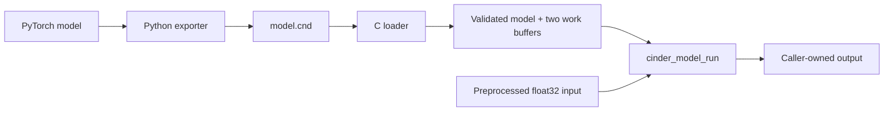

# Cinder

A tiny neural-network inference runtime in C, built to make the forward pass
understandable: load weights, multiply vectors, apply activations, and produce
an output.

Cinder runs sequential **Dense, ReLU, and Softmax** layers on the CPU using
float32 parameters and vectors. A Python exporter converts supported PyTorch
models to `.cnd` files. Training happens outside the C runtime; the C build
needs no Python or third-party numerical library.

**Current source: v0.1.1 — publication pending.** The executable reports
`Cinder 0.1.1`. The [release notes](RELEASE_NOTES.md) describe the new model
inspection command and its compatibility with existing models.

**Previously released:** [v0.1.0](https://github.com/farukumarx64/cinder/releases/tag/v0.1.0)
on **October 30, 2026**. The [publication record](docs/RELEASE_VERIFICATION.md#publication-record)
identifies tagged commit `d4e96db` and its five passing macOS/Linux CI jobs.
The [v0.1.0 roadmap](ROADMAP.md#current-progress) is complete through M7.

**New in v0.1.1:** `cinder info <model.cnd>` inspects model
structure and parameter counts. This command is available in the current
source tree; the published v0.1.0 tag does not include it. See the
[inspection guide and verification](docs/INFO.md).

## Installation

Build from source on macOS or Linux. You need:

- Git, CMake **3.16 or newer**, and Make or Ninja.
- A C11 compiler: Apple Clang, Clang, or GCC.
- The system C and math libraries; CMake handles linking them.

On macOS, the Xcode Command Line Tools provide the compiler and Make
(`xcode-select --install`); install CMake separately. On Linux, install a C
compiler, development headers, CMake, Make or Ninja, and Git through your
package manager. Verified configurations include macOS 15/27 and Ubuntu 24.04;
exact compiler versions are in the verification report.

```sh
git clone https://github.com/farukumarx64/cinder.git
cd cinder
```

The commands below run from this repository root. There is currently no CMake
install target or packaged binary: use the executable in the build directory.

## Build and run

Create a Release build, run the saved C tests, and check the version:

```sh
cmake -S . -B build-release -DCMAKE_BUILD_TYPE=Release -DBUILD_TESTING=ON
cmake --build build-release --parallel
(cd build-release && ctest --output-on-failure)
./build-release/cinder --version
```

Expected version output:

```text
Cinder 0.1.1
```

Generated files belong in `build/` or `build-*/`, which Git ignores. CMake
remembers options per build directory; use a fresh directory for a new setup.
The ordinary build and tests use committed fixtures without Python, network
access, or an MNIST download.

### Run a model

```text
cinder run <model.cnd> <input.bin>
```

Run the committed MNIST model and the input for official test image 0:

```sh
./build-release/cinder run examples/mnist/mnist.cnd \
  tests/fixtures/mnist/inputs/00000.f32
```

Recorded output on macOS; final score digits can vary within the numerical
tolerance. Each score row contains a tab:

```text
Model: mnist.cnd
Prediction: 7
Scores:
7	0.9978019
3	0.0018843736
2	0.000236767111
```

`run` prints the greatest output's zero-based index and the best `min(3, M)`
scores for an `M`-output model. Exact ties favor the smaller index. These are
raw model outputs: probabilities when the model ends in Softmax, otherwise
potentially logits or other scores. For this MNIST model, index `i` means digit
`i`; `.cnd` v1 does not store class labels.

For a model with `D` inputs, the input file must contain exactly **D finite,
little-endian IEEE binary32 floats** (`4 * D` bytes), without a header, padding,
or trailing data. The `.f32` fixture suffix is valid; suffixes are descriptive.
The CLI does not decode images or preprocess values. For MNIST, flatten a
28 × 28 image in row-major order, convert pixels to float32, and divide by
float32 `255.0`: 784 values / 3,136 bytes.

The smaller worked example is also ready to run:

```sh
./build-release/cinder run tests/fixtures/tiny/tiny.cnd \
  tests/fixtures/tiny/inputs/worked.f32
```

It predicts index 0 with scores approximately `0.904650509` and `0.0953494608`.
See the [CLI contract](docs/CLI.md) and [MNIST demonstration](examples/mnist/DEMO.md)
for exact formatting, preprocessing, and reproduction details.

### Benchmark inference

```sh
./build-release/cinder bench examples/mnist/mnist.cnd \
  tests/fixtures/mnist/inputs/00000.f32 --iterations 1000
```

`bench` requires `--iterations N` after the two paths. `N` must contain decimal
digits and be between **1 and 1,000,000**, inclusive. The model and input are
loaded once and the output buffer is allocated before execution. Ten fixed,
untimed warm-ups precede the requested measured calls on the same input.

The report includes iteration and warm-up counts, clock resolution in
nanoseconds, mean/minimum/maximum latency in microseconds (`us`), and throughput
in inferences per second. Throughput is `N / total measured inference seconds`.

Each interval measures one `cinder_model_run` call, including its validation
and input/output copies. Loading, allocation, preprocessing, warm-ups, printing,
and between-call observation/statistics are excluded. Use an ordinary Release
build for timing; sanitizers add overhead. This measures inference API latency,
not complete application throughput.

Very short models can produce equal start/end clock readings. Cinder stops with
an error and publishes no timing report; it does not retry, round up, or batch
samples. Increasing `--iterations` cannot fix a zero-length individual interval.
See the [benchmark contract](docs/BENCHMARK.md) and
[timing investigation](docs/TIMING_INVESTIGATION.md).

### Inspect a model (v0.1.1)

```sh
./build-release/cinder info examples/mnist/mnist.cnd
```

```text
Model: mnist.cnd
Input: 784
Output: 10
Layers: 4
  0: Dense 784 -> 128 (parameters: 100480)
  1: ReLU 128 -> 128 (parameters: 0)
  2: Dense 128 -> 10 (parameters: 1290)
  3: Softmax 10 -> 10 (parameters: 0)
Parameters: 101770
```

`info` loads and validates the model without an input file or inference. Dense
counts include every weight and bias; activations have no learned parameters.
Indices start at zero, and layer dimensions show the execution order. It uses
the normal loader, including allocation of the model's two working buffers.
See [the full command and metadata API](docs/INFO.md) for errors and ownership.

### Exit statuses and errors

| Status | Meaning |
| --- | --- |
| `0` | The command and its output completed successfully. |
| `1` | Model/input, allocation, inference, timing, or output failure. |
| `2` | Invalid command or arguments. |

Diagnostics go to stderr. Failures before printing leave stdout empty; a write
failure may leave partial output. Paths are literal file paths: quote spaces,
and do not use `-` as stdin. The current source supports `--version`, `run`, `bench`, and `info`;
there is no `--help`. The published v0.1.0 supports the first three commands.

## Architecture and memory ownership



The loader validates headers, dimensions, connections, parameter values, and
resource limits before returning an executable model. Layers execute in order.
A Dense layer computes `y = Wx + b`, with row-major weights shaped
`[output_size][input_size]`. Dense alternates between the two model-owned work
buffers; ReLU and Softmax update the current vector in place. Work buffers are
sized for the largest vector in the model and reused without inference-time
allocations. Softmax subtracts the maximum and uses double intermediates with
float32 storage for numerical stability.

| Resource | Owner and lifetime |
| --- | --- |
| Loaded model | The caller receives it from `cinder_model_load` and releases it once with `cinder_model_free`. It no longer depends on the source file. |
| Layers and work buffers | The model owns and frees them. Successful `cinder_model_create` adopts the supplied layers and clears the caller's slots; failure leaves them caller-owned. |
| Dense weights and biases | Each Dense layer owns copies of its parameters. Original constructor arrays can be released after successful construction. |
| Input, output, error details | Caller-owned; no caller buffers are retained after a call. Input and output ranges must be disjoint and genuinely accessible for their advertised lengths. |

The public API in [`include/cinder/model.h`](include/cinder/model.h) provides
load/create, input/output size accessors, run, and free. Repeated calls need no
reset. `cinder_model_run` copies the final result into caller output only after
the entire sequence succeeds; every returned failure preserves caller output,
and spare output capacity remains untouched. Lower-level kernels have their
own documented failure rules and may partially update output on arithmetic
failure.

A model's work buffers are mutable: **serialize calls on the same model**, or
use independent model instances. There is no internal lock. Do not modify
parameters or destroy an owner while it is in use. See the [model contract](docs/MODEL.md),
[layer contract](docs/LAYER.md), and [loader contract](docs/LOADER.md).

## Measured results

Accuracy and runtime agreement answer different questions:

| Measurement | Result | Scope |
| --- | --- | --- |
| Python MNIST accuracy | **97.48%** (9,748/10,000) | Official test split, held out of training; saved reference checkpoint. |
| C and Python fixture accuracy | **99/100 each** | Fixed official test indices `0..99`. |
| C/Python prediction agreement | **100/100** | Same prediction, including the shared incorrect answer. |
| C/Python stage agreement | **27,600 values pass** | First Dense, ReLU, logits, and probabilities; shape/finite checks and `atol = rtol = 1e-5`. |

The largest recorded MNIST stage error across the verified macOS/Linux builds
is `6.67572021e-6`; maximum probability error is `3.57627869e-7`. Full 10,000-image
C accuracy has not been measured. See [training results](examples/mnist/RESULTS.md),
[stage validation](examples/mnist/VALIDATION.md), and [M6 verification](docs/M6_VERIFICATION.md).

The October 28 Release baseline used Apple M4, macOS 27.0.1, Apple Clang 21,
`-O3 -DNDEBUG`, no sanitizers/LTO, and source commit `cd461c6`. Each of five
attempts per model requested 100,000 measured calls after ten warm-ups:

| Model | Valid attempts | Median of valid trial mean latencies |
| --- | ---: | ---: |
| Tiny `2 → 4 → 2` | **4/5** | **0.159771025 us** |
| MNIST `784 → 128 → 10` | **5/5** | **105.936159 us** |

The failed tiny attempt is retained in the [baseline report](docs/benchmarks/2026-10-28-apple-m4/README.md).
These describe one desktop and fixed inputs, not guaranteed speeds. An
[unchanged-executable comparison](docs/M5_VERIFICATION.md) showed variation
without an optimization; later timing investigation reproduced frequent tiny
zero-interval failures. No speedup claim is made from those runs.

## Run the tests

For a separate Debug build:

```sh
cmake -S . -B build-debug -DCMAKE_BUILD_TYPE=Debug -DBUILD_TESTING=ON
cmake --build build-debug --parallel
(cd build-debug && ctest --output-on-failure)
```

The **39 ordinary C tests** cover numerical references, malformed files,
allocation/I/O failures, exact and spare buffer boundaries, cleanup, recovery,
repeated inference, and CLI/benchmark errors. Timing tests use controlled values
without a machine-speed threshold. `-Wall -Wextra -Wpedantic` applies to all C
targets. To build only the executable and libraries, configure a separate build
with `-DBUILD_TESTING=OFF`.

### Optional Python tools

Python **3.11+** is needed only for exporting, training, or regenerating/testing
references. From the repository root, create a virtual environment:

```sh
python3 -m venv .venv
.venv/bin/python -m pip install -r tests/requirements-numpy.txt
```

Install the pinned PyTorch dependency on macOS:

```sh
.venv/bin/python -m pip install -r tools/requirements-exporter.txt
```

On Linux, use CPU wheels instead:

```sh
.venv/bin/python -m pip install --index-url https://download.pytorch.org/whl/cpu \
  -r tools/requirements-exporter.txt
```

Enable all nine optional tests in a separate build:

```sh
cmake -S . -B build-python -DCMAKE_BUILD_TYPE=Debug -DBUILD_TESTING=ON \
  -DCINDER_ENABLE_NUMPY_TESTS=ON -DCINDER_ENABLE_EXPORTER_TESTS=ON \
  -DCINDER_ENABLE_MNIST_TESTS=ON -DPython3_EXECUTABLE="$PWD/.venv/bin/python"
cmake --build build-python --parallel
(cd build-python && ctest --output-on-failure)
```

This runs **48 tests** using saved data, without downloading MNIST or retraining
the reference model. The [exporter guide](docs/EXPORTER.md) documents
`tools.export_model.export_model(model, path, *, input_size=None)` for supported
`nn.Sequential` models. Use evaluation mode before export; unsupported layers,
connections, dtypes, or parameter configurations are rejected explicitly.
For the saved MNIST checkpoint, verify identical export without overwriting it:

```sh
.venv/bin/python examples/mnist/export.py --check
```

[MNIST reproduction](examples/mnist/README.md) covers training and dataset setup;
[NumPy references](docs/NUMPY_TESTS.md) and the [round-trip guide](docs/ROUND_TRIP.md)
cover fixture regeneration and Python export → C load → inference comparisons.

## Sanitizer builds

Build with AddressSanitizer (memory access errors) and UndefinedBehaviorSanitizer
(undefined behavior) in a separate directory. On Linux, select Clang by adding
`-DCMAKE_C_COMPILER=clang` to this configuration command; on macOS, use the
default Apple Clang:

```sh
cmake -S . -B build-sanitize -DCMAKE_BUILD_TYPE=Debug -DBUILD_TESTING=ON \
  -DCINDER_ENABLE_ASAN=ON -DCINDER_ENABLE_UBSAN=ON
cmake --build build-sanitize --parallel
```

On the verified macOS toolchain, LeakSanitizer is unavailable:

```sh
(cd build-sanitize && ASAN_OPTIONS=detect_leaks=0:halt_on_error=1 \
  UBSAN_OPTIONS=halt_on_error=1:print_stacktrace=1 ctest --output-on-failure)
leaks --atExit -- ./build-release/cinder run examples/mnist/mnist.cnd \
  tests/fixtures/mnist/inputs/00000.f32
```

On Linux with Clang and LeakSanitizer support, run:

```sh
(cd build-sanitize && ASAN_OPTIONS=detect_leaks=1:halt_on_error=1 \
  UBSAN_OPTIONS=halt_on_error=1:print_stacktrace=1 ctest --output-on-failure)
```

Native `leaks` needs permission to inspect its process; an inspection error is
not a passing check. The [candidate report](docs/RELEASE_VERIFICATION.md) records
eight native checks with zero leaks, successful local Debug/Release/sanitizer
suites, a fresh Python environment, and
[all five hosted jobs](https://github.com/farukumarx64/cinder/actions/runs/41029277234)
passing at `1e5a5f6`. Local builds also enforced `-Werror`. Hosted CI covers
macOS/Linux Debug and Release plus Linux ASan/UBSan/LeakSanitizer. Ordinary jobs
use C fixtures; Linux Debug adds the optional Python suite. Hosted native macOS
leak checking remains unavailable. See the [CI workflow](.github/workflows/ci.yml).

## Limitations

- Inference is sequential, single-vector CPU execution. There is no C training,
  GPU backend, convolution, quantization, explicit SIMD kernels, batched inference,
  or internal multithreading. The exporter supports a defined PyTorch subset,
  not arbitrary graphs or checkpoint formats.
- `.cnd` v1 stores little-endian binary32 parameters. Hosts must support the
  required float representation and wider double intermediates. Limits include
  1,024 layers, 65,536 values per vector, and 64 MiB of parameter payload; peak
  memory also includes copies, work buffers, and allocation overhead.
- Model and input files must be seekable and stable while read. The format has
  structural/resource checks but no checksum, signature, class labels, or
  preprocessing metadata. See the [format contract](docs/MODEL_FORMAT.md).
- Buffer validity, lifetime, overlap rules, and shared-model synchronization
  remain caller responsibilities. Finite inputs can still overflow during
  arithmetic and produce an error. Passing fixtures, fault injection, and
  sanitizers are not an exhaustive correctness or memory-safety proof.
- Tiny-model benchmark intervals may be unresolved by the clock. Measurements
  are not portable performance guarantees. `cinder info` is available in v0.1.1;
  see the [inspection guide](docs/INFO.md).

## Repository layout

| Path | Purpose |
| --- | --- |
| `include/cinder/` | Public tensor, Dense, layer, model, and error APIs. |
| `src/` | C runtime, `.cnd` loader, CLI/input reader, timer, and benchmark code. |
| `tools/` | Python model validation and binary exporter. |
| `examples/mnist/` | Training/export scripts, saved checkpoint/model, and demonstration reports. |
| `tests/` | C and optional Python tests, deterministic fixtures, and generators. |
| `docs/` | Contracts, numerical/lifecycle evidence, benchmarks, and investigation reports. |
| `CMakeLists.txt`, `.github/workflows/ci.yml` | Build configuration, CTest registration, and hosted checks. |

## Documentation

Start with the [MNIST demonstration](examples/mnist/DEMO.md) for the end-to-end
workflow. API details live in the [tensor](docs/TENSOR.md), [Dense](docs/DENSE.md),
[layer](docs/LAYER.md), and [model](docs/MODEL.md) contracts; file details are in
[model format](docs/MODEL_FORMAT.md) and [loader](docs/LOADER.md).

Development history and evidence remain in the [roadmap](ROADMAP.md),
[release audit](docs/RELEASE_AUDIT.md), [GCC warning investigation](docs/GCC_WARNINGS.md),
[timing investigation](docs/TIMING_INVESTIGATION.md),
[robustness review](docs/ROBUSTNESS_REVIEW.md), and
[M6 verification](docs/M6_VERIFICATION.md). The [release notes](RELEASE_NOTES.md)
describe v0.1.1 changes and the published v0.1.0 scope and constraints. The
[release report](docs/RELEASE_VERIFICATION.md) preserves verification of candidate
`1e5a5f6` and publication of `v0.1.0` at `d4e96db`, with CI evidence for each.

## License

[MIT License](LICENSE). Copyright (c) 2026 Faruk Umar.
